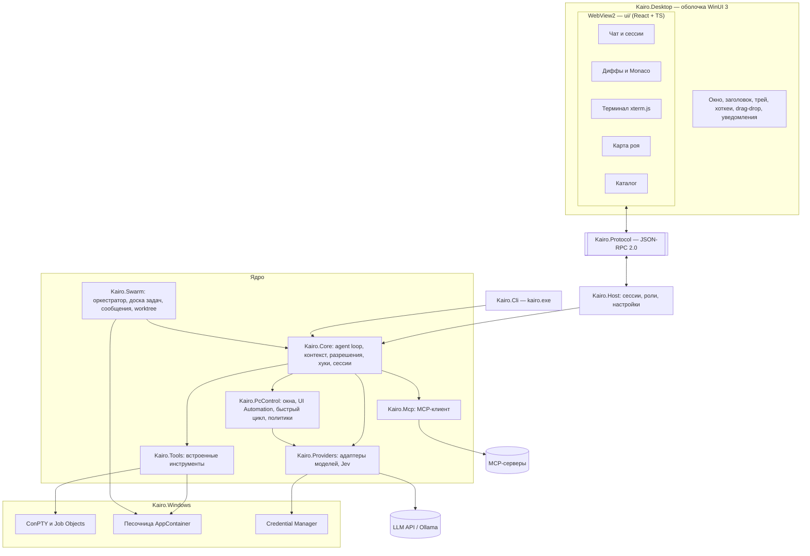

# Архитектура

> Стек: **.NET 10 (C#) + WebView2 (React/TS)**, обоснование в [ADR-0001](adr/0001-tech-stack.md).

## Обзор



## Принципы

1. **Ядро — библиотека, интерфейсы — тонкие клиенты.** Вся логика в `Kairo.Core` и соседях. Десктоп и CLI только показывают события и передают ввод. Агента можно тестировать без GUI.
2. **Один протокол, разные транспорты.** UI и ядро общаются по JSON-RPC 2.0. В M2 транспорт — сообщения WebView2 внутри одного процесса. Позже тот же протокол пойдёт через named pipe / WebSocket: фоновый процесс, где рой работает при закрытом окне, и удалённый UI с телефона.
3. **У интерфейса нет полномочий.** UI сообщает о намерениях пользователя, а решения принимает ядро. См. [мост](#мост-ui--ядро).
4. **Ядро совместимо с AOT.** Никакой рефлексии в `Core`, `Providers`, `Mcp`, `Swarm`, `Protocol`: System.Text.Json source generators, CsWin32 для interop.

## Проекты

| Проект | Что внутри | Зависит от |
|---|---|---|
| `Kairo.Protocol` | DTO и методы JSON-RPC; источник TS-типов | — |
| `Kairo.Core` | Agent loop, контекст, compaction, разрешения, хуки, сабагенты, сессии, чекпоинты | Protocol |
| `Kairo.Providers` | Адаптеры моделей, профили возможностей, лимиты запросов | Core |
| `Kairo.Mcp` | MCP-клиент, OAuth | Core |
| `Kairo.Tools` | Read, Write, Edit, Glob, Grep, Shell, WebFetch… | Core, Windows |
| `Kairo.Swarm` | Рой: лид и воркеры в git worktrees, доска задач, сообщения, бюджеты, пауза и продолжение (CLI `kairo swarm` и раздел «Рой» в приложении); git по проверенному каталогу worktree, инструмент `Git` только для чтения | Core, Tools |
| `Kairo.PcControl` | Управление ПК: окна и UI Automation (`UiaDesktop`, не AOT), `PcGuard`, быстрый цикл `PursueLoop`, политики и рефлексы, фоновая очередь запусков, журнал решений, инструменты `Pc*`, красная плашка | Core, Providers |
| `Kairo.Windows` | Всё про Win32 / COM: хранилище ключей Credential Manager, ConPTY, песочница AppContainer | Core |
| `Kairo.Host` | Хост агентов для любого UI: сессии, фоновые ходы, события протокола, ожидание разрешений, настройки, выбор провайдера. Сейчас живёт в процессе десктопа, позже — фоновый процесс | Core, Providers, Tools |
| `Kairo.Cli` | `kairo.exe` | Host, Windows |
| `Kairo.Desktop` | Оболочка WinUI 3 + хост WebView2 + нативный выбор папки | Host, Windows |
| `ui/` | React-интерфейс | (генерированные типы Protocol) |

## Kairo.Core

### Agent loop

`prompt → модель → tool calls → разрешения → выполнение → результаты → модель …` до финального ответа. Всё стримится наружу как поток событий, отмена — через `CancellationToken` в любой момент.

```csharp
public interface IAgent
{
    IAsyncEnumerable<AgentEvent> RunAsync(UserTurn turn, CancellationToken ct);
}

// AgentEvent: TextDelta, ThinkingDelta, ToolCallStarted, PermissionRequested,
//             ToolCallCompleted, TodoUpdated, TurnCompleted, Error
```

### Инструменты

Единый интерфейс для встроенных инструментов, MCP и инструментов роя:

```csharp
public interface ITool
{
    ToolSpec Spec { get; }                      // имя, описание, JSON Schema входа
    RiskLevel Assess(JsonElement input);        // Read | Write | Exec | System | Network
    Task<ToolResult> InvokeAsync(JsonElement input, ToolContext ctx, CancellationToken ct);
}
```

### Остальное

- **Контекст.** System prompt собирается из: базового промпта, `AGENTS.md` / `CLAUDE.md` по иерархии папок, памяти, описаний скиллов и активного агента. При приближении к лимиту окна — compaction: модель пишет сводку, и дальше она видит только сводку и новые сообщения (`Compaction` в `Kairo.Core/Agents`). Журнал сессии в SQLite остаётся append-only: сводка — ещё одно сообщение, лента в интерфейсе показывает на её месте разделитель. Порог — `[context] window` и `compact_at` в `config.toml` (по умолчанию 128 000 токенов и 0,8; `window = 0` отключает автосжатие). Размер берётся из usage последнего вызова и из оценки по длине текста, что больше. Сводку просят написать по тексту переписки без инструментов, поэтому подписи thinking и парность tool-вызовов её не касаются.
- **Разрешения.** См. [SECURITY-MODEL](SECURITY-MODEL.md).
- **Хуки.** Внешние команды на события (`PreToolUse`, `PostToolUse`, `UserPromptSubmit`, `Stop`…). Могут заблокировать или изменить действие. Формат стараемся держать совместимым с Claude Code.
- **Сабагенты.** Синхронный вызов: отдельный экземпляр loop со своим контекстом, инструментами и моделью, который возвращает родителю только итог. Для долгой параллельной работы — [рой](#kairoswarm).
- **Сессии и чекпоинты.** SQLite (`Microsoft.Data.Sqlite`) для сообщений и метаданных + снимок файла перед каждой правкой агента для отката.

## Kairo.Providers

Собственный нормализованный формат сообщений (текст, изображения, tool_use, tool_result, thinking) и адаптеры:

| Адаптер | Основа | Покрывает |
|---|---|---|
| `anthropic` | официальный Anthropic C# SDK | Claude |
| `openai` | официальный OpenAI .NET SDK | GPT, Responses API |
| `gemini` | Google GenAI SDK / HTTP | Gemini |
| `openai-compatible` | HTTP + SSE | OpenRouter, DeepSeek, Groq, vLLM, LM Studio |
| `ollama` | HTTP | локальные модели |
| `extensions-ai` | `IChatClient` | всё остальное, что реализует `Microsoft.Extensions.AI` |

Почему свой интерфейс, а не только `IChatClient`: нужны специфичные для провайдеров вещи — prompt caching, thinking-блоки, серверные инструменты, точный учёт стоимости. `IChatClient` используем как адаптер для всего остального.

- **Профиль модели:** окно контекста, tool calling, vision, reasoning, кэширование, цена. Агент аккуратно деградирует: без vision, например, нет скриншотов.
- **Модели решений (System 1).** Отдельный тип провайдера — `IDecisionModel`: выбор из вариантов, оценка по шкале, вероятность «да» вместо генерации текста. Первый адаптер — Jev (NuGet `TypeSafe.Jev`), запасной — эмуляция на любой быстрой LLM. Используется в управлении ПК, позже — в маршрутизации и рое. См. [ADR-0002](adr/0002-pc-control-system1-system2.md).
- **Лимиты:** `System.Threading.RateLimiting` — ограничение параллельных запросов и RPM/TPM на провайдера и ключ. Критично для роя.

## Чекпоинты

`TurnRecorder` (`Kairo.Core/Checkpoints`) получает управление от `Write`/`Edit` через `ToolContext.History`: до записи файла сохраняется его прежнее состояние в таблицы `checkpoints` / `checkpoint_files` базы сессий, после записи — хеш результата. Чекпоинт создаётся при первой записанной правке в запросе, у запросов без правок его нет. `Rollback.Preview/Apply` считает по записанному: для каждого файла берётся состояние до его первой правки начиная с выбранного запроса, а «своими» считаются все состояния, в которых агент оставлял файл; любое другое текущее содержимое — конфликт. Хост передаёт интерфейсу только id чекпоинта и пути из предпросмотра.

## Терминал

`IPty` / `IPtyFactory` в `Kairo.Core`, реализация на ConPTY в `Kairo.Windows` (`LibraryImport`, без рефлексии). `TerminalService` в `Kairo.Host` собирает вывод в пакеты по ~8 мс и отправляет по порядку; в интерфейсе xterm.js (`ui/src/terminal/registry.ts`) живёт вне React и сохраняет прокрутку при скрытии панели. Правила безопасности — в [SECURITY-MODEL](SECURITY-MODEL.md#терминал).

Нюансы ConPTY, на которые уже наступили: у дочернего процесса нужно обнулить стандартные дескрипторы (`STARTF_USESTDHANDLES`), иначе он пишет в консоль родителя; перед `ClosePseudoConsole` нужно дать выводу догнать, иначе последние строки быстро завершившихся команд теряются.

## Kairo.Mcp

Официальный C# SDK (`ModelContextProtocol.Core`, без DI и хостинга). Транспорты stdio и Streamable HTTP; OAuth для удалённых серверов — позже.

- **Конфиг:** `%APPDATA%\Kairo\mcp.json` в формате Claude Desktop (`mcpServers`: `command`/`args`/`env` или `url`/`headers`, плюс `disabled`). Импорт из `claude_desktop_config.json` — по кнопке; существующие имена не перезаписываются. Файл пишется только по действию пользователя.
- **Проектные конфиги (`.mcp.json` в репозитории) не читаются:** открытие чужого репозитория не должно запускать процессы. Появятся вместе с явным подтверждением на каждый сервер.
- **Инструменты:** `mcp__<server>__<tool>` (только `A-Za-z0-9_`, до 64 символов, уникальные). Риск всегда `exec`, то есть спрашиваем: подсказкам сервера вроде `readOnlyHint` не доверяем. Правило `mcp__server__*` разрешает все инструменты одного сервера; «Да, и не спрашивать» разрешает инструмент целиком, а не только эти аргументы.
- **Отказоустойчивость:** сервер, который не стартовал или завис (таймаут 30 с), показывается как «Ошибка» и не мешает остальным. Перезагрузка сохраняет подключения, чья конфигурация не изменилась. Процессы stdio останавливаются при закрытии приложения.

## Kairo.Swarm

Рой — долгоживущие параллельные агенты с ролями, общей доской задач, сообщениями и изолированными рабочими пространствами (git worktree). Каждый агент роя — обычный экземпляр agent loop из `Kairo.Core`. Подробно — в [спецификации роя](specs/swarm.md).

Две вещи, о которых важно помнить при изменениях:

- **Команды воркеров идут в песочнице по умолчанию** (`SandboxPolicy`, значение `[sandbox] shell` по умолчанию — `workers`). Лид команд не выполняет.
- **git в worktree воркера запускается только по каталогу, найденному из основного репозитория** (`GitWorkspace.TrustedGitDirAsync`), а не по файлу `.git` в worktree: воркер пишет в свой worktree и мог бы подменить этот файл конфигом, выполняющим команды (`core.fsmonitor`). Новые git-вызовы роя в worktree должны идти через `RunInWorktreeAsync`.

## Kairo.PcControl

Управление ПК: System 2 (большая модель) через инструменты `PcWindows`, `PcLaunch`, `PcObserve`, `PcAct`, `PcScreenshot`, `PcCheck`, `PcPursue`, `PcRunPolicy`, `PcRuns`; System 1 (`IDecisionModel` в `Kairo.Core/Decisions`, адаптер Jev в `Kairo.Providers`) решает шаги быстрого цикла. Проект не AOT: UI Automation идёт через COM. Подробно — [управление ПК](specs/pc-control.md), [политики решений](specs/decision-policy.md), риски — [SECURITY-MODEL](SECURITY-MODEL.md#управление-пк).

| Часть | Что делает |
|---|---|
| `IDesktop` / `UiaDesktop` | Окна, дерево UI Automation одним кэшированным чтением, действия через паттерны, стабильные id элементов |
| `PcGuard` | Список программ из `[pc]`, запрет на терминалы, менеджеры паролей, системные инструменты, редакторы кода; слова и сочетания, которые считаются рискованными |
| `Candidates` + `PursueLoop` | Варианты шага из дерева, один запрос к Jev на шаг, ворота уверенности и риска, эскалация, проверка результата |
| `PolicyRunner`, `Policy.cs` | Проверка и исполнение JSON-политики: шаги, тексты, рефлексы, лимиты |
| `PcRunQueue` (`PcRuns.cs`) | Фоновые запуски: System 1 работает, пока System 2 планирует |
| `DecisionHistory` | Журнал решений без содержимого и порог уверенности по программам |
| `ControlOverlay` | Красная плашка поверх всех окон, пока работает инструмент `Pc*` |

## Kairo.Windows

Низкоуровневый доступ к системе без логики агента.

| Возможность | Реализация |
|---|---|
| Win32 interop | `LibraryImport` (source generators, совместимо с AOT) |
| Shell-терминал | ConPTY + Job Objects (убить всё дерево процессов) |
| Песочница | AppContainer + Job Object (память, дерево процессов) + `icacls` для доступа к папкам; отказ вместо обхода. Запасные варианты (Windows Sandbox, WSL) не делались |
| Секреты | `CredWrite` / `CredRead` (Credential Manager) |

Окна, UI Automation, ввод (`SendInput`) и скриншоты (копирование области экрана) лежат в `Kairo.PcControl`, потому что завязаны на логику управления ПК.

## Kairo.Desktop

- Окно WinUI 3: свой заголовок на системном фоне (`SolidBackgroundFillColorBaseBrush`).
- Один WebView2 на всё окно; цвета интерфейса совпадают с заголовком окна.
- UI грузится из локальной папки через `SetVirtualHostNameToFolderMapping` на `https://app.kairo.local/`: не через `file://` и никакого удалённого контента в главном фрейме.
- Нативно, а не в вебе: трей, глобальная горячая клавиша (`RegisterHotKey`), окно быстрого ввода поверх всех окон, перетаскивание из Проводника (в UI приходят только пути), toast-уведомления (`AppNotificationManager`), системный акцентный цвет и тема (передаются в UI).
- Установщик и автообновление: Velopack или MSIX, решаем в M0.

## Мост UI ↔ ядро

- **Транспорт:** `CoreWebView2.PostWebMessageAsJson` / `WebMessageReceived`. `AddHostObjectToScript` **не используем**: он слишком широко открывает .NET-объекты в JS.
- **Протокол:** JSON-RPC 2.0. Запросы от UI (`session.send`, `session.cancel`, `permission.respond`, `swarm.start`, `swarm.stop`…) и уведомления от ядра (`agent.event`, `swarm.updated`…).
- **Типы:** описаны один раз как C# records в `Kairo.Protocol`, TS-типы генерируются при сборке (инструмент выбираем в M0).
- **Правила безопасности:**
  1. Методы — намерения, а не команды. `permission.respond { id: 42, decision: "allow" }` — да; `shell.run { cmd }` — такого метода не существует. Ядро проверяет, что запрос #42 действительно ждёт ответа.
  2. Белый список методов; источник каждого сообщения проверяется (`https://app.kairo.local`).
  3. Вывод модели → Markdown → санитайзер, без сырого HTML. Строгий CSP (`script-src 'self'`). Ссылки открываются во внешнем браузере после подтверждения. Mermaid и SVG рендерятся в sandbox-iframe.
  4. Навигация за пределы origin приложения блокируется (`NavigationStarting`), новые окна — тоже.

## UI (`ui/`)

| Задача | Инструмент |
|---|---|
| Фреймворк | React + TypeScript + Vite |
| Оформление | Своя дизайн-система в духе редактора кода, без UI-библиотек — [ADR-0004](adr/0004-editor-style-ui.md) |
| Markdown со стримингом | react-markdown + remark-gfm, без сырого HTML |
| Редактор и диффы | Monaco (ленивая загрузка) |
| Терминал | xterm.js (ленивая загрузка) |
| Карта роя | React Flow |
| Стили | CSS с дизайн-токенами (`ui/src/styles.css`) |
| Состояние | Zustand |

**Нативное ощущение** (правило 3 из ADR):
- шрифт Segoe UI Variable, системные акцентный цвет и тема;
- учёт системной настройки «Эффекты анимации» (`prefers-reduced-motion`);
- никакого выделения текста и «веб-курсоров» на элементах оболочки, полная навигация с клавиатуры;
- виртуализация длинных списков, токены стрима рендерятся пакетами раз в кадр, 60+ FPS.

## Хранение

```
%APPDATA%\Kairo\
  config.toml          # глобальные настройки
  mcp.json             # MCP-серверы (формат совместим с Claude Desktop)
  agents\  swarms\  skills\  memory\
  data.db              # сессии, состояние роёв (SQLite)
  checkpoints\
<project>\.kairo\
  config.toml          # настройки проекта, правила разрешений
  agents\  swarms\  skills\  commands\  hooks\
```

Секреты (API-ключи, OAuth-токены) хранятся **только** в Windows Credential Manager, никогда в файлах.

## Структура репозитория

```
kairo/
  Kairo.slnx
  Directory.Build.props        # общие настройки: net10.0, nullable, analyzers, AOT-проверки
  src/
    Kairo.Protocol/
    Kairo.Core/
    Kairo.Providers/
    Kairo.Mcp/
    Kairo.Tools/
    Kairo.Swarm/
    Kairo.PcControl/
    Kairo.Windows/
    Kairo.Host/
    Kairo.Cli/
    Kairo.Desktop/
  ui/                          # React + Vite
  tests/
    Kairo.Core.Tests/          # xUnit; провайдеры — запись/воспроизведение HTTP
    evals/                     # набор задач для регрессий агента
  docs/
```
