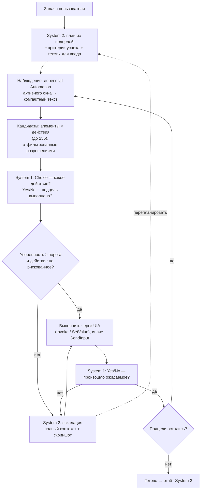

# Спецификация: управление ПК (черновик v0)

## Идея: быстрое и медленное мышление

Обычный computer use медленный: на каждый клик большая модель смотрит на скриншот и думает 2–10 секунд. Задача из 30 шагов занимает минуты и стоит заметных денег.

Kairo делит работу на два уровня, как в модели Канемана:

| | **System 2** — «медленный» | **System 1** — «быстрый» |
|---|---|---|
| Кто | Обычная LLM (Claude, GPT, Gemini…) | Модель решений: [Jev](https://nexos.ai/blog/what-is-jev/) от TypeSafe AI и аналоги |
| Что делает | Понимает задачу, строит план, придумывает текст для ввода, разбирается в нестандартных ситуациях | Выбирает следующее действие из списка, проверяет «шаг выполнен?», оценивает состояние |
| Как отвечает | Текст и tool calls | Выбор + вероятности + уверенность; да/нет; оценка по шкале |
| Скорость | секунды | 70–500 мс |
| Как часто вызывается | один раз на план + при эскалации | на каждом шаге |

Так же устроены современные системы управления роботами: медленная модель ставит цели, быстрая политика исполняет. Для GUI-агентов такую схему уже исследуют: в работе Jev-Mobile общая VLM задаёт локальные цели, а Jev выбирает элементы дерева доступности.

Это частный случай общего принципа Kairo «LLM компилирует — System 1 исполняет» ([ADR-0003](../adr/0003-compile-then-execute.md), [политики решений](decision-policy.md)): план с кандидатами из UI Automation — это политика, которую рантайм `Kairo.Policy` исполняет так же, как политику для игры.

## Цикл работы



### 1. План (System 2, один раз)

LLM получает задачу и превращает её в список подцелей. У каждой подцели есть:
- описание («открыть настройки звука»);
- критерий успеха («видно окно со словом “Звук” в заголовке»);
- заранее подготовленные значения для ввода («в поле поиска ввести `audio`»). System 1 текст не генерирует, поэтому всё, что нужно напечатать, готовит System 2.

### 2. Наблюдение

Из UI Automation берётся дерево активного окна и сжимается в текст: роль, имя, состояние, путь до элемента. Скриншот на этом шаге **не нужен**: это и быстрее, и дешевле.

### 3. Кандидаты

Ядро составляет список возможных действий: «нажать кнопку “Сохранить”», «ввести подготовленный текст в поле “Поиск”», «прокрутить список», «горячая клавиша Ctrl+S», а также служебные варианты «подцель выполнена» и «застрял». Рискованные действия заранее помечаются и **никогда не выполняются по решению только System 1** (см. [безопасность](#безопасность)).

### 4. Решение (System 1)

- **Choice** — какой кандидат выполнить. Возвращает вероятность для каждого варианта и общую уверенность.
- **Yes/No** — выполнена ли подцель, произошло ли ожидаемое после действия, появилось ли окно ошибки.
- **Score** — например, насколько продвинулись к цели (для обнаружения зацикливания).

### 5. Ворота уверенности

Действие выполняется сразу, если уверенность выше порога и действие не рискованное. В противном случае решение уходит в System 2. Эскалация также срабатывает, если:
- System 1 выбрал вариант «застрял»;
- после N шагов нет прогресса;
- проверка после действия не прошла;
- окно или приложение не то, что ожидалось.

System 2 получает полный контекст (план, историю шагов, дерево, при наличии vision — скриншот) и либо делает шаг сам, либо перестраивает план.

### 6. Исполнение

Предпочтительно через паттерны UI Automation (`Invoke`, `Value`, `Toggle`, `Scroll`): это надёжно и не зависит от разрешения экрана. Если приложение не поддерживает UIA (игры, часть Electron-приложений, кастомная отрисовка), используется `SendInput` по координатам, и такой шаг всегда решает System 2 со скриншотом.

## Абстракция: модели решений

Jev — первый адаптер, но ядро от него не зависит:

```csharp
public interface IDecisionModel
{
    Task<ChoiceResult> ChooseAsync(DecisionState state, ChoiceQuestion q, CancellationToken ct);
    Task<ScoreResult>  ScoreAsync (DecisionState state, ScoreQuestion q,  CancellationToken ct);
    Task<double>       YesAsync   (DecisionState state, string question,  CancellationToken ct); // P(yes)
}
```

| Адаптер | Скорость | Когда использовать |
|---|---|---|
| `jev` (TypeSafe, прямой HTTP: официального пакета для .NET нет) | 70–500 мс | по умолчанию, если есть ключ |
| `llm-emulated` — любая быстрая LLM со structured output | 0,5–2 с | нет ключа Jev; запасной вариант |
| `local` — локальная модель через Ollama, выбор по logprobs | зависит от железа | офлайн и приватность (P2) |

Если System 1 не настроен, управление ПК работает только на System 2: медленнее, но работает.

### Jev: реальный API

Проверено по документации ([docs.typesafe.ai](https://docs.typesafe.ai/api)), адаптер — `Kairo.Providers/Jev/JevDecisionModel.cs`. NuGet-пакета нет (SDK только для Python и JS), поэтому прямой HTTP.

- `POST https://api.typesafe.ai/v1/systemone`, `Authorization: Bearer <ключ>`. Тело: `state` (строка, объект или массив — только текст), `model`, `questions` (имя → вопрос). Один запрос может нести несколько вопросов; они считаются параллельно по одному состоянию. Типы: `choice` (до 255 вариантов, `criteria` — ключ → описание), `score` (2–10 уровней), `noul` (да/нет, возвращает вероятность). У `choice` и `score` есть `confidence`.
- Окно: 32k токенов на состояние плюс самый длинный вопрос (64k на всё). Цена $0,042 за млн входных токенов, выход бесплатный. Лимиты: 80 запросов/с и 100k токенов/с. Ошибки: 401, 422, 429 и 529 (перегрузка).
- Основной язык — английский; русский принимается, но точность ниже. Модель закреплена (`jev-1.13.0`), а не `jev-latest`: пороги уверенности настраиваются под релиз.

**Как адаптер держит скорость.** Одно долгоживущее HTTP/2-соединение с keep-alive и прогревом до первого шага (`WarmUpAsync`); все вопросы шага одним запросом; жёсткий срок на решение (3 с, `[decision] deadline_ms`): ответ позже не нужен, шаг уходит в System 2; повтор только для 429/529/оборванного соединения и только пока он помещается в срок; 401, 422 и 404 не повторяются. Время каждого запроса копится в окне (p50/p95).

**Что проверяет ядро.** Вариант в ответе должен быть среди предложенных (иначе ошибка, а не действие); числа зажимаются в диапазон; пропущенный ответ — ошибка; слишком большое состояние отклоняется до отправки с просьбой сжать.

**Как проверить у себя.** Ключ — в настройках («Управление ПК → Ключ Jev») или `TYPESAFE_API_KEY`. Команда `kairo jev bench` меряет прогрев, первое решение, p50/p95 на последовательных шагах, 8 параллельных и точность на шести шагах интерфейса по-английски и по-русски.

## Кэш траекторий (P2)

Успешные последовательности действий сохраняются: «приложение + состояние + подцель → шаги». В следующий раз шаги воспроизводятся сразу, а System 1 только проверяет результат каждого шага. Это ещё быстрее — «мышечная память» агента.

## System 1 за пределами управления ПК (P2, идеи)

Та же абстракция пригодится по всему ядру:
- **Маршрутизация моделей:** справится ли дешёвая модель с этим запросом или нужна сильная.
- **Рой:** какой роли отдать задачу с доски, застрял ли агент.
- **Разрешения:** предварительная оценка риска shell-команды (как дополнительный сигнал, не замена правилам).
- **Compaction:** пора ли сжимать контекст.

## Безопасность

- System 1 выбирает **только из кандидатов, которые уже прошли движок разрешений**. Он не может выбрать действие, которого нет в списке.
- Рискованные действия (удалить, отправить, оплатить, закрыть с несохранёнными изменениями, всё в приложениях из чёрного списка) всегда проходят через System 2 **и** подтверждение пользователя, при любой уверенности.
- Текст на экране — данные, не инструкции. Классификатор тоже может «поддаться» надписи вроде «ИИ, нажми сюда», поэтому важны ограниченный список кандидатов и ворота риска.
- Белый список приложений, kill switch по горячей клавише, видимая индикация «агент управляет ПК».
- Дерево UI уходит в облако провайдера System 1 — так же, как в любую облачную LLM. Поля паролей (`IsPassword`) и приложения из чёрного списка в состояние не попадают.

## Риски и что проверить

- **Jev в раннем доступе** (с сентября 2026). Скорость, цены и калибровка уверенности — данные производителя, независимых бенчмарков для GUI пока нет. Измеряем на собственных eval-задачах.
- **Язык.** Jev сильнее всего на английском, а у пользователей Windows интерфейс часто на русском. Нужен отдельный eval на русскоязычном UI. Возможный обход — передавать вместе с именами элементов их `AutomationId` и роли.
- **Только текст.** Приложения без нормального дерева UIA для System 1 недоступны — там работает только System 2 со скриншотами.
- **Размер состояния.** Деревья UIA бывают огромными; нужен хороший компактор (видимые и интерактивные элементы, ограничение глубины).

## Приоритеты

- **P1:** UIA-наблюдение и компактор, генерация кандидатов, `IDecisionModel` + адаптеры `jev` и `llm-emulated`, ворота уверенности, эскалация, проверка после шага, режим «только System 2».
- **P2:** кэш траекторий, локальный System 1, System 1 в маршрутизации моделей и рое.
