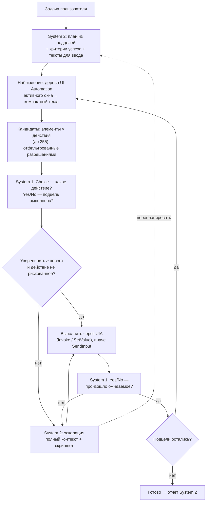

# Спецификация: управление ПК (черновик v0)

## Идея: быстрое и медленное мышление

Обычный computer use медленный: на каждый клик большая модель смотрит на скриншот и думает 2–10 секунд. Задача из 30 шагов занимает минуты и стоит заметных денег.

Kairo делит работу на два уровня, как в модели Канемана:

| | **System 2** — «медленный» | **System 1** — «быстрый» |
|---|---|---|
| Кто | Обычная LLM (Claude, GPT, Gemini…) | Модель решений: [Jev](https://nexos.ai/blog/what-is-jev/) от TypeSafe AI и аналоги |
| Что делает | Понимает задачу, строит план, придумывает текст для ввода, разбирается в нестандартных ситуациях | Выбирает следующее действие из списка, проверяет «шаг выполнен?», оценивает состояние |
| Как отвечает | Текст и tool calls | Выбор + вероятности + уверенность; да/нет; оценка по шкале |
| Скорость | секунды | 70–500 мс |
| Как часто вызывается | один раз на план + при эскалации | на каждом шаге |

Так же устроены современные системы управления роботами: медленная модель ставит цели, быстрая политика исполняет. Для GUI-агентов такую схему уже исследуют: в работе Jev-Mobile общая VLM задаёт локальные цели, а Jev выбирает элементы дерева доступности.

Это частный случай общего принципа Kairo «LLM компилирует — System 1 исполняет» ([ADR-0003](../adr/0003-compile-then-execute.md), [политики решений](decision-policy.md)): план с кандидатами из UI Automation — это политика, которую рантайм `Kairo.Policy` исполняет так же, как политику для игры.

## Цикл работы



### 1. План (System 2, один раз)

LLM получает задачу и превращает её в список подцелей. У каждой подцели есть:
- описание («открыть настройки звука»);
- критерий успеха («видно окно со словом “Звук” в заголовке»);
- заранее подготовленные значения для ввода («в поле поиска ввести `audio`»). System 1 текст не генерирует, поэтому всё, что нужно напечатать, готовит System 2.

### 2. Наблюдение

Из UI Automation берётся дерево активного окна и сжимается в текст: роль, имя, состояние, путь до элемента. Скриншот на этом шаге **не нужен**: это и быстрее, и дешевле.

### 3. Кандидаты

Ядро составляет список возможных действий: «нажать кнопку “Сохранить”», «ввести подготовленный текст в поле “Поиск”», «прокрутить список», «горячая клавиша Ctrl+S», а также служебные варианты «подцель выполнена» и «застрял». Рискованные действия заранее помечаются и **никогда не выполняются по решению только System 1** (см. [безопасность](#безопасность)).

### 4. Решение (System 1)

- **Choice** — какой кандидат выполнить. Возвращает вероятность для каждого варианта и общую уверенность.
- **Yes/No** — выполнена ли подцель, произошло ли ожидаемое после действия, появилось ли окно ошибки.
- **Score** — например, насколько продвинулись к цели (для обнаружения зацикливания).

### 5. Ворота уверенности

Действие выполняется сразу, если уверенность выше порога и действие не рискованное. В противном случае решение уходит в System 2. Эскалация также срабатывает, если:
- System 1 выбрал вариант «застрял»;
- после N шагов нет прогресса;
- проверка после действия не прошла;
- окно или приложение не то, что ожидалось.

System 2 получает полный контекст (план, историю шагов, дерево, при наличии vision — скриншот) и либо делает шаг сам, либо перестраивает план.

### 6. Исполнение

Предпочтительно через паттерны UI Automation (`Invoke`, `Value`, `Toggle`, `Scroll`): это надёжно и не зависит от разрешения экрана. Если приложение не поддерживает UIA (игры, часть Electron-приложений, кастомная отрисовка), используется `SendInput` по координатам, и такой шаг всегда решает System 2 со скриншотом.

## Абстракция: модели решений

Jev — первый адаптер, но ядро от него не зависит:

```csharp
public interface IDecisionModel
{
    Task<ChoiceResult> ChooseAsync(DecisionState state, ChoiceQuestion q, CancellationToken ct);
    Task<ScoreResult>  ScoreAsync (DecisionState state, ScoreQuestion q,  CancellationToken ct);
    Task<double>       YesAsync   (DecisionState state, string question,  CancellationToken ct); // P(yes)
}
```

| Адаптер | Скорость | Когда использовать |
|---|---|---|
| `jev` (TypeSafe, прямой HTTP: официального пакета для .NET нет) | 70–500 мс | по умолчанию, если есть ключ |
| `llm-emulated` — любая быстрая LLM со structured output | 0,5–2 с | нет ключа Jev; запасной вариант |
| `local` — локальная модель через Ollama, выбор по logprobs | зависит от железа | офлайн и приватность (P2) |

Если System 1 не настроен, управление ПК работает только на System 2: медленнее, но работает.

### Jev: реальный API

Проверено по документации ([docs.typesafe.ai](https://docs.typesafe.ai/api)), адаптер — `Kairo.Providers/Jev/JevDecisionModel.cs`. NuGet-пакета нет (SDK только для Python и JS), поэтому прямой HTTP.

- `POST https://api.typesafe.ai/v1/systemone`, `Authorization: Bearer <ключ>`. Тело: `state` (строка, объект или массив — только текст), `model`, `questions` (имя → вопрос). Один запрос может нести несколько вопросов; они считаются параллельно по одному состоянию. Типы: `choice` (до 255 вариантов, `criteria` — ключ → описание), `score` (2–10 уровней), `noul` (да/нет, возвращает вероятность). У `choice` и `score` есть `confidence`.
- Окно: 32k токенов на состояние плюс самый длинный вопрос (64k на всё). Цена $0,042 за млн входных токенов, выход бесплатный. Лимиты: 80 запросов/с и 100k токенов/с. Ошибки: 401, 422, 429 и 529 (перегрузка).
- Основной язык — английский; русский принимается, но точность ниже. Модель закреплена (`jev-1.13.0`), а не `jev-latest`: пороги уверенности настраиваются под релиз.

**Как адаптер держит скорость.** Одно долгоживущее HTTP/2-соединение с keep-alive и прогревом до первого шага (`WarmUpAsync`); все вопросы шага одним запросом; жёсткий срок на решение (3 с, `[decision] deadline_ms`): ответ позже не нужен, шаг уходит в System 2; повтор только для 429/529/оборванного соединения и только пока он помещается в срок; 401, 422 и 404 не повторяются. Время каждого запроса копится в окне (p50/p95).

**Что проверяет ядро.** Вариант в ответе должен быть среди предложенных (иначе ошибка, а не действие); числа зажимаются в диапазон; пропущенный ответ — ошибка; слишком большое состояние отклоняется до отправки с просьбой сжать.

**Как проверить у себя.** Ключ — в настройках («Управление ПК → Ключ Jev») или `TYPESAFE_API_KEY`. Команда `kairo jev bench` меряет прогрев, первое решение, p50/p95 на последовательных шагах, 8 параллельных и точность на шести шагах интерфейса по-английски и по-русски.

## Статус реализации (первый срез)

Сделано: `Kairo.PcControl`, команды `kairo pc run` и `kairo jev bench`, инструменты `PcWindows`, `PcLaunch`, `PcObserve`, `PcAct`, `PcPursue`; настройки `[pc]` и `[decision]`. Безопасность — в [SECURITY-MODEL.md](../SECURITY-MODEL.md#управление-пк).

- **Наблюдение.** Дерево UI Automation активного окна и его диалогов и меню, одним пакетным чтением с кэшем (24–55 мс на Блокноте, до 850 мс на диалоге «Сохранить как»). В тексте: роль, имя, `AutomationId`, состояние, что можно сделать. Невидимое отбрасывается, до 250 элементов.
- **Кандидаты.** Из дерева: нажать, переключить, раскрыть, выбрать, прокрутить; ввод только подготовленных текстов; сочетания только из плана; служебные «готово» и «застрял». Для пункта меню — один вариант (два близнеца делили бы уверенность). Риск определяет ядро.
- **Один запрос на шаг.** Вопросы `next` (выбор), `achieved` (цель достигнута?) и `effect` (прошлый шаг сработал?) идут в Jev вместе.
- **Ворота и эскалация.** Низкая уверенность, рискованный шаг, «застрял», два шага без эффекта, неизменный экран, провал быстрой модели или действия — цикл возвращает экран и желаемый шаг большой модели.
- **Исполнение.** Паттерны `Invoke`, `Value`, `Toggle`, `ExpandCollapse`, `SelectionItem`, `Scroll`; `SendInput` — для сочетаний и набора в сфокусированном элементе; клик мышью — только для пунктов классического меню.
- **Стабильные id.** Один и тот же элемент окна имеет один и тот же id во всех просмотрах (путь в дереве + номер среди одинаковых соседей; проверено на проводнике: 162 из 162 id совпали между просмотрами). Поэтому большая модель может делать несколько действий подряд без просмотра между ними, а `PcAct` в окне больше 80 элементов возвращает не всё дерево, а **что изменилось** (`+` новое с id, `~` изменилось, `-` исчезло), если модель уже видела это окно целиком. Когда изменений слишком много, возвращается всё окно.
- **System 1 и System 2 работают вместе, а не по очереди.** (1) *Фон:* `PcPursue` и `PcRunPolicy` с `background: true` возвращают номер запуска сразу и идут в очереди по одному (`PcRunQueue`), пока большая модель думает над следующим шагом; `PcRuns` (`await`/`status`/`cancel`) собирает результаты. Первый запуск, который не закончился успехом, отменяет остальные в очереди (они планировались под экран, которого нет). Пока запуск в очереди, `PcAct`, `PcLaunch`, `PcScreenshot` и обычные `PcPursue`/`PcRunPolicy` отказывают (клавиатура и мышь одни); `PcObserve`, `PcWindows`, `PcCheck` доступны. Остановка хода отменяет и запуски, красная плашка висит всё время очереди. (2) *Журнал и порог:* каждое решение цикла пишется в `pc-decisions.jsonl` (программа, вид шага, уверенность, что сделал экран; без заголовков, имён и текста), а порог уверенности для программы поднимается, если шаги на нём часто не меняли экран (нужно 30+ шагов; «поднимается до самой низкой уверенности, с которой шаги работали на 90%», потолок 0,95). Порог никогда не опускается ниже заданного пользователем: у невзятых шагов нет исхода, и по ним нельзя узнать, что можно было смелее. `kairo pc stats` показывает по программам долю сработавших шагов по полосам уверенности, причины передачи большой модели и итоговый порог. Выключается `[pc] calibrate = false`. (3) *Больше решений у Jev:* два вопроса да/нет идут в том же запросе, что и выбор шага (без лишней задержки): «самый прямой шаг необратим» и «последние шаги идут по кругу». Ответ «да» может только передать шаг большой модели. По `kairo jev probe`: риск на безопасных шагах 0,03–0,29, на необратимых 0,45–0,88 (порог 0,5; ловит публикацию, деплой, merge, которых нет в списке слов; пропускает «заблокировать контакт» 0,45 и «дать права администратора» 0,16), прогресс на нормальных шагах 0,80–0,96, на зацикленных 0,04–0,07 (порог 0,3, два ответа подряд). Отключается `[pc] semantic_checks = false`. `PcCheck` даёт большой модели ответ да/нет с вероятностью за ~0,35 с вместо чтения всего окна.
- **Что видит Jev про открытое поверх окна.** В снимок добавлена строка «Open on top of the window: …» (выпавшее меню, диалог или «nothing»), а у пустых полей ввода видно `= ""`. Раньше классификатор принимал пункт «Формат» в строке меню за открытое меню («меню Формат открыто» получало 0,97 при закрытом меню; теперь 0,05) и не мог проверить, что поле пусто.
- **Цикл шага (быстрее и точнее).** Пауза после действия короткая (30 мс), потом цикл смотрит экран и, если он ещё такой же, ждёт ещё до двух раз по 70 мс: медленное приложение не считается «застрявшим», быстрое не ждёт зря (действие 141 → 45–60 мс). Модель решений получает не только экран, но и **что изменилось** после прошлого шага (появилось/исчезло) и **последние четыре шага** с результатом («экран изменился»/«ничего не изменилось»): это лучше всего отвечает на вопрос «сработал ли прошлый шаг» и защищает от зацикливания. Всплывающее меню и диалог получают свой запас элементов (+150) и идут в кандидатах первыми, поэтому большое окно их не обрезает. Именованный элемент без паттернов (строка списка, веб-контент) можно кликнуть мышью: `click:eN` в кандидатах, а `PcAct click` на элементе без Invoke кликает по его центру. Первый прогрев Jev делает один настоящий крошечный запрос (первое решение после простоя бывало 2,4 с вместо 0,3). Читать дерево одним запросом с кэшем поддерева проверено и отброшено: на среднем окне быстрее (212 против 343 мс), на браузерном медленнее (71 против 24 мс). Решение (~260–290 мс) почти всё — сеть и сервер: напрямую и через локальный прокси то же самое (p50 261 и 267 мс).
- **Замеры** (Блокнот, русский интерфейс, свой ключ Jev): «записать приветствие» — 2 решения, 1,1 с; «Файл → Сохранить как…» — 3 решения, 2,2 с (решение ≈ 300–500 мс, чтение 25–55 мс, действие ≈ 140 мс вместе с паузой 120 мс).

Есть настройки в приложении (флажок, список программ из открытых окон, ключ Jev), красная плашка «Kairo управляет ПК» поверх всех окон (и индикатор в строке состояния Kairo), политики v0 (ниже) и режим зрения для моделей, читающих изображения (`[pc] vision = true`): `PcScreenshot`, `click_at`, `double_click_at`, `type_focused`. Зрение проверено на живом Блокноте с моделью пользователя: она по одной картинке назвала цвета и пункты меню по порядку. Живой прогон «большая модель → `PcLaunch` → `PcPursue` → `PcObserve`» на Блокноте прошёл: быстрая часть заняла пару секунд из 88 с общего времени, остальное — размышления большой модели.

Не сделано: игровая часть политик (OCR, шаблоны, захват кадров), пересмотр политик по логам, глобальная горячая клавиша вместо опроса Pause (опрос работает из любой программы), адаптер `llm-emulated`, кэш траекторий, выбор «быстрой» части на скриншотах (Jev читает только текст: пиксельные шаги всегда решает большая модель).

## Политики v0 для программ с деревом UI Automation

Принцип [ADR-0003](../adr/0003-compile-then-execute.md) («LLM компилирует — System 1 исполняет») реализован для программ, которые видно через UI Automation: `Policy.cs`, `PolicyRunner.cs`, инструмент `PcRunPolicy`. Игровая часть формата ([decision-policy.md](decision-policy.md): захват кадров, OCR, шаблоны, пиксели) в v0 не входит.

Большая модель один раз пишет политику — JSON-данные, не код:

```json
{
  "$schema": "kairo.policy/v0",
  "goal": "Сохранить заметку как report.txt",
  "target": { "app": "notepad.exe" },
  "texts": { "name": "report.txt" },
  "steps": [
    { "id": "open", "goal": "Открыть диалог «Сохранить как»", "until": "Открыт диалог «Сохранить как»", "hotkeys": ["ctrl+shift+s"] },
    { "id": "name", "goal": "Ввести имя и сохранить", "until": "В заголовке окна report.txt", "texts": ["name"], "hotkeys": ["enter"], "max_steps": 8 }
  ],
  "reflexes": [
    { "name": "overwrite", "when": { "window_title_contains": "Подтверждение", "element": { "role": "button", "name_contains": "Да" } },
      "do": { "invoke": { "role": "button", "name_contains": "Да" } }, "max_fires": 2 }
  ],
  "limits": { "max_steps": 60, "max_seconds": 120 }
}
```

- **Шаги** идут по порядку; каждый исполняет быстрый цикл (`PursueLoop`) со своими текстами и сочетаниями. `until` — как выглядит экран, когда шаг сделан. Первый шаг, который не закончился (неуверенность, рискованный шаг, застрял, лимит), останавливает прогон и возвращает экран большой модели: она решает этот шаг сама (`PcAct`) и при желании запускает остаток.
- **Рефлексы** — детерминированные правила без модели: если в заголовке есть текст и/или на экране есть элемент (роль, имя целиком или часть, `AutomationId`), то нажать найденный элемент или сочетание. Сработать могут не более `max_fires` раз за прогон. Выражений нет, только эти структурные условия.
- **Проверка до запуска.** Парсер собирает **все** ошибки сразу (чтобы модель исправила их за один раз): схема, цель, программа из списка и не из запрещённых, тексты и сочетания, уникальные id, не больше 30 шагов и 20 рефлексов, лимиты ограничены (шагов не больше 300, времени не больше 900 с).
- **Показ пользователю.** Окно подтверждения перечисляет программу, каждый шаг (цель, критерий, тексты, сочетания), каждый рефлекс и лимиты. Рискованный клик можно заложить только в рефлекс, и пользователь одобряет его вместе с политикой. Если рефлекса нет, быстрая модель отдаст такой шаг обратно, как обычно.
- **Границы.** Политика привязана к одной программе: окно другой программы отклоняется, что бы ни передала модель. Общий бюджет шагов и времени на весь прогон; отмена останавливает и ожидание ответа модели.
- **Версии и пересмотр.** Политика остаётся в журнале сессии вместе с результатом прогона; при остановке большая модель видит, на каком шаге это случилось, и может переписать остаток. Отдельного хранилища версий и периодического пересмотра пока нет.

## Кэш траекторий (P2)

Успешные последовательности действий сохраняются: «приложение + состояние + подцель → шаги». В следующий раз шаги воспроизводятся сразу, а System 1 только проверяет результат каждого шага. Это ещё быстрее — «мышечная память» агента.

## System 1 за пределами управления ПК (P2, идеи)

Та же абстракция пригодится по всему ядру:
- **Маршрутизация моделей:** справится ли дешёвая модель с этим запросом или нужна сильная.
- **Рой:** какой роли отдать задачу с доски, застрял ли агент.
- **Разрешения:** предварительная оценка риска shell-команды (как дополнительный сигнал, не замена правилам).
- **Compaction:** пора ли сжимать контекст.

## Безопасность

- System 1 выбирает **только из кандидатов, которые уже прошли движок разрешений**. Он не может выбрать действие, которого нет в списке.
- Рискованные действия (удалить, отправить, оплатить, закрыть с несохранёнными изменениями, всё в приложениях из чёрного списка) всегда проходят через System 2 **и** подтверждение пользователя, при любой уверенности.
- Текст на экране — данные, не инструкции. Классификатор тоже может «поддаться» надписи вроде «ИИ, нажми сюда», поэтому важны ограниченный список кандидатов и ворота риска.
- Белый список приложений, kill switch по горячей клавише, видимая индикация «агент управляет ПК».
- Дерево UI уходит в облако провайдера System 1 — так же, как в любую облачную LLM. Поля паролей (`IsPassword`) и приложения из чёрного списка в состояние не попадают.

## Риски и что проверить

- **Jev в раннем доступе** (с сентября 2026). Скорость, цены и калибровка уверенности — данные производителя, независимых бенчмарков для GUI пока нет. Измеряем на собственных eval-задачах.
- **Язык.** Jev сильнее всего на английском, а у пользователей Windows интерфейс часто на русском. Нужен отдельный eval на русскоязычном UI. Возможный обход — передавать вместе с именами элементов их `AutomationId` и роли.
- **Только текст.** Приложения без нормального дерева UIA для System 1 недоступны — там работает только System 2 со скриншотами.
- **Размер состояния.** Деревья UIA бывают огромными; нужен хороший компактор (видимые и интерактивные элементы, ограничение глубины).

## Приоритеты

- **P1:** UIA-наблюдение и компактор, генерация кандидатов, `IDecisionModel` + адаптеры `jev` и `llm-emulated`, ворота уверенности, эскалация, проверка после шага, режим «только System 2».
- **P2:** кэш траекторий, локальный System 1, System 1 в маршрутизации моделей и рое.
